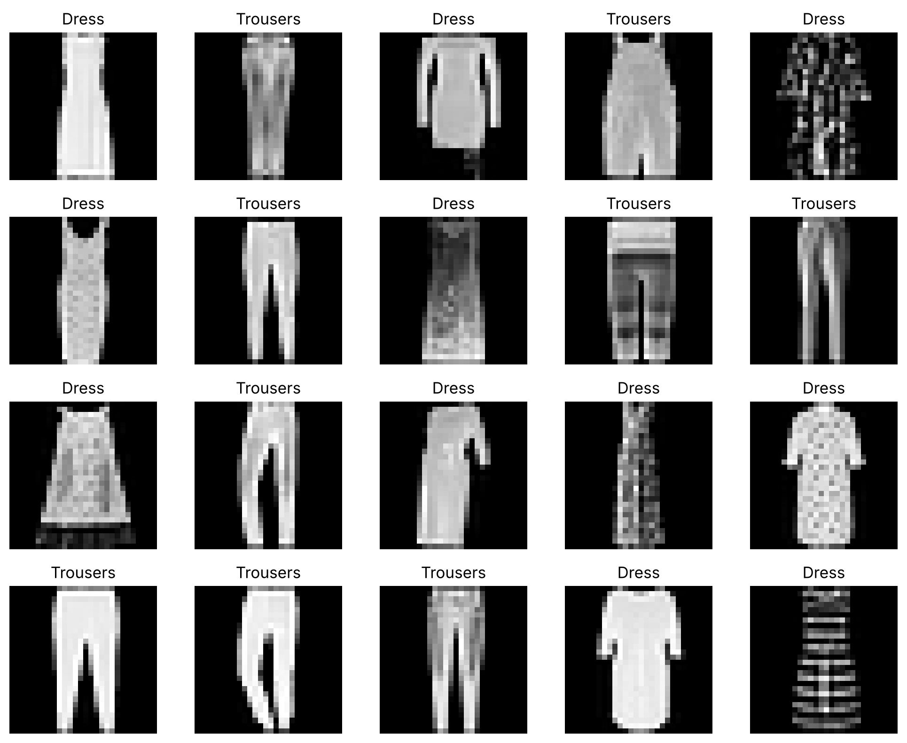
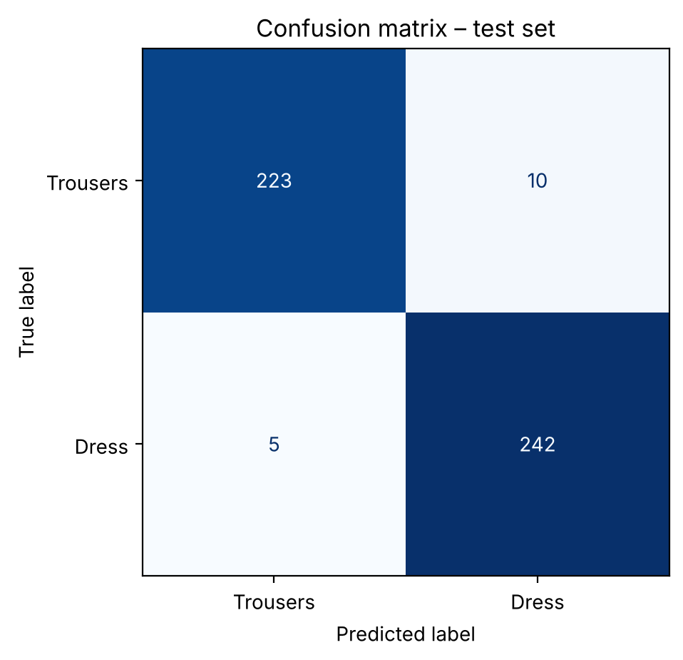

# Classifying Fashion-MNIST Images with Classical ML and Dimensionality Reduction

How well can classical machine learning models tell trousers from dresses using only raw pixels, and does reducing the number of features help?

This project compares SVM, naive Bayes and linear discriminant analysis (LDA) on 2,400 Fashion-MNIST images (28×28 pixels, 784 features). It tests four preprocessing methods and tunes each model's hyperparameters. Then it combines every model with PCA and locally linear embedding (LLE).



## Results

The best model is an **SVM with min-max scaling and PCA (11 components)**. It reached **98.96% validation accuracy** and **96.88% accuracy on the held-out test set** (F1 0.97 for both classes).

Best validation accuracy for each model, by feature space:

| Model | All pixels | PCA | LLE |
|---|---|---|---|
| **SVM** | 98.75% | **98.96%** | 96.67% |
| LDA | 97.92% | 97.50% | 95.21% |
| Gaussian NB | 95.42% | 95.62% | 94.58% |
| Multinomial NB | 94.38% | – | – |
| Bernoulli NB | 93.96% | 89.17% | 91.04% |

Multinomial NB cannot be combined with PCA or LLE, because both produce negative values.



### Main findings
- SVM was the strongest model family. Eleven principal components were enough to slightly beat the SVM on all 784 pixels.
- LDA improved from 91.5% to 97.9% once its covariance estimate was regularised (shrinkage).
- LLE lowered accuracy for every model compared with using all pixels.

### Limitations
- Hundreds of configurations were ranked on one validation set of 480 images, so the selection is somewhat optimistic. This shows in the gap between validation and test accuracy. Cross-validation would give a more reliable estimate.
- The LLE parameter search was kept small because of computation time.
- Only two of the ten Fashion-MNIST classes are used.

## Method

1. Split the labelled data into training (60%), validation (20%) and test (20%) sets, with a fixed random seed.
2. Train baseline models on raw pixels.
3. Compare min-max scaling, robust scaling, standardisation and binarisation.
4. Tune hyperparameters with a grid search on the validation set.
5. Add PCA or LLE and tune their settings together with each model.
6. Evaluate the best model once on the test set.

## Repository structure

```
├── fashion_mnist.ipynb   # full analysis, with outputs
├── data/
│   ├── train.csv                      # 2,400 labelled images (label 0 = trousers, 1 = dress)
│   └── evaluate.csv                   # 9,600 unlabelled images
├── images/                            # figures used in this README
└── requirements.txt
```

## How to run

```bash
pip install -r requirements.txt
jupyter notebook fashion_mnist.ipynb
```

The whole notebook runs in about 3 minutes on a laptop. The last section saves predictions for the unlabelled images to `result.csv`.

Results were produced with scikit-learn 1.9.1. Other versions may give slightly different numbers for Bernoulli NB with PCA or LLE, and for LDA with LLE. The final SVM model is not affected.

## Data

The images come from [Fashion-MNIST](https://github.com/zalandoresearch/fashion-mnist) by Zalando Research, released under the MIT License. This project uses a subset with two classes: trousers and dresses.

## About

Originally developed as coursework in machine learning at the Faculty of Information Technology, Czech Technical University in Prague. Restructured and documented as a standalone project.

**Tools:** Python, scikit-learn, pandas, NumPy, Matplotlib, Jupyter
